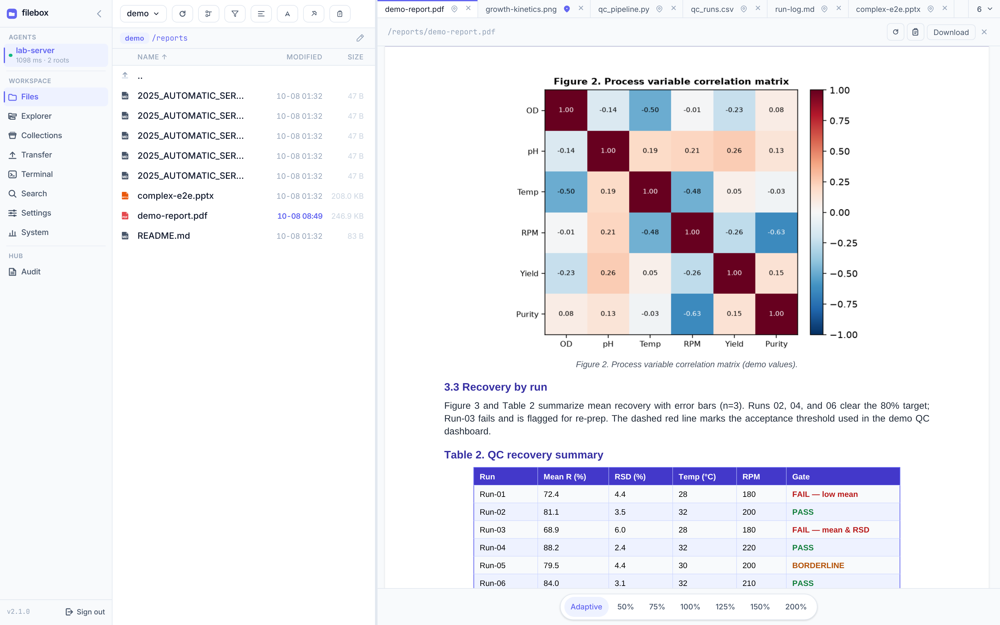

# filebox

**Browse the files on any server from one secure web page.**

<p align="center">
  <a href="https://zhimingye.github.io/filebox/">
    
  </a>
</p>

filebox is a read-only remote file browser with system monitoring. Install a
small agent on each machine you want to reach, host the hub on a server you
control, and open a single URL — from your desktop or your phone, wherever
you are. Every machine is one click away, with no public IP on the target,
no port forwarding, and no SSH gymnastics.

[](https://github.com/ZhimingYe/filebox/releases/latest)
[](LICENSE)

> **[Documentation →](https://zhimingye.github.io/filebox/)** — install,
> connect, and use every feature, with screenshots of the real UI.
>
> **[中文文档 →](https://zhimingye.github.io/filebox/zh/)** — 安装、连接、浏览、多标签预览、搜索、合集、传输与 Herdr。

## Why filebox

Most coding agents are built for software developers. filebox is built for
the people those agents tend to overlook: researchers and analysts who need
to *see* their results — the figures, the PDFs, the logs — to be confident
the results are right. While the tooling world drifts toward hosted,
editor-centric workflows, research still lives on self-hosted servers, where
results are files. filebox gives that world a dependable front door — one
click away from any browser, laptop, phone, or tablet — so a result can be
checked from the lab bench, the conference hall, or the train home.

## How it works

```text
Browser ──HTTPS──▶ Hub ◀──WSS (outbound)── Agent ──▶ local files
```

- **Web app** — the browser interface you use to browse, search, and monitor.
- **Hub** — one central server that authenticates users, serves the web app,
  and routes every request to the right machine.
- **Agent** — a small daemon installed on each machine whose files you want
  to reach.

Agents always connect **outward** to the hub. The machines you want to reach
need no inbound ports and no public address — only the hub has to be
reachable. When a machine comes back after an outage, its agent reconnects
on its own, with no duplicate entries and no lost configuration.

## Features

### File browsing

- Smooth file lists even in very large directories
- Directory tree and breadcrumb address bar with paste-and-go and autocomplete
- Filter by filename pattern or modification date
- File-type badges and recently-changed highlighting
- Remembers your place — positions survive a page refresh
- Pin folders you use often for one-click access
- Click a preview's path to open its folder in Files or reveal it in Explorer

### Search

- Find by file name, or search file contents with regular expressions
- Scope a search to a folder, filter by extension, skip noise folders such
  as `node_modules` or `venv`
- Live progress with cancel — safe on very large trees

### Collections

- Save named lists of files from any of a machine's folders
- View items side by side, remove them, or jump to their original location
- Stored on the machine; nothing is moved or copied — they are virtual references

### Preview

- Multi-tab workspace with keyboard shortcuts
- Markdown, code (find, wrap, syntax highlighting), PDF, images (zoom and
  pan, including TIFF), HTML in a sandboxed session, and CSV tables
- Quarto (`.qmd`) and R Markdown (`.rmd`, `.rmarkdown`) as read-only source
  with front-matter and code-chunk highlighting (not executed)
- Jupyter notebooks (`.ipynb`) with Markdown, code, text/error output and
  images, without running a kernel
- HTML with relative links and self-contained Quarto/Pandoc reports, plus
  Source and new-window views
- Optional Office conversion: Word and PowerPoint open as PDF, spreadsheets
  as per-sheet CSV
- Pin preview tabs to keep their state while you switch
- Oversized files ask before loading instead of freezing the browser

### System monitoring

- CPU, memory, and load overview
- Per-user resource share
- Process table with per-process details

### Security

- Browsing is read-only. Transfer writes only to its dedicated scratch folder;
  the separate AI Agents integration permits whitelisted coding-agent operations.
- AI agent prompts must pass a Hub-side LLM security review before they reach
  the coding agent
- Per-user logins; a separate token authenticates each machine
- Sensitive files (credentials, private keys, shell history, `.env`, and
  more) are denied by default, even inside allowed folders
- Browsing is strictly confined to the folders you allow — symlinks,
  `..`, and other escape routes are blocked
- Several Hubs on one host keep separate logins; changing the Agent token or
  Hub port requires signing in again

### Operations

- Works on phones and tablets — browse, search, and monitor from anywhere,
  not just at your desk
- Live status feed with request progress and cancellation
- Agents reconnect automatically after outages — identity persists, no duplicates
- Browsing, heartbeats and cancel stay responsive during slow transfers
  (update the Agent as well as the Hub)
- One-command in-place updates

### Temp files

- **Transfer** view: drag small files onto the page and the agent stores them
  in one dedicated scratch folder — the only path where an agent ever writes.
  Per-file and total quotas, no overwrites, one-click cleanup, and the folder
  is never browsable as a normal root.
- Paste screenshots or copied images with Ctrl/Cmd+V in Transfer; they use
  the same limits as dropped files

### Coding agents (optional)

- **AI Agents** view: list coding agents, read their output, send prompts and
  answer with allowlisted keys (pi, Claude Code and Codex profiles), with
  reminders when an agent needs input. Install the
  [Herdr CLI](https://herdr.ink) (checked against v0.9.5) on the Agent
  machine, or set `FILEBOX_AGENT_HERDR`, then use **Check installation**.
  Turn it on or off per backend in Agent Settings;
  `FILEBOX_AGENT_AI_AGENTS_ENABLED=0`/`1` at Agent startup overrides and locks
  that switch. Not a general-purpose remote shell; reminders need an open
  page. See [the shortcut guide](docs/herdr-shortcuts.md).
- **Experimental hc backend**: select **hc (experimental)** in Agent Settings
  to list and control herdr-core coding agents labelled `filebox=ai-agent`.
  Only local live terminals are included; the existing Herdr backend is unchanged.
  See [hc setup and compatibility](docs/hc-compatibility.md).
- Every prompt passes a Hub-side LLM security review first: destructive
  commands, permanent deletion and secret extraction are blocked; normal data
  analysis and development go through. The reviewer sees the prompt and the
  window's recent output. Configured only in `hub.json`
  (`prompt_review`), never in the web UI; if it is missing or the
  review fails, the prompt is refused. Start the Hub with
  `FILEBOX_HUB_PROMPT_REVIEW_ENABLED=0` to turn review off. The AI Agents
  view shows the review state (on with its model, off, or not configured). See
  [Herdr compatibility and prompt review](docs/herdr-compatibility.md).

## Markdown math

Markdown previews render math locally with KaTeX (no CDN). Supported forms:
`$...$`, `$$...$$` (inline or multiline), `\(...\)`, `\[...\]`, GitHub's
`` $`...`$ ``, and fenced `math`, `latex`, `tex`, or `katex` blocks.
Standalone `math`, `displaymath`, `equation`, `align`, `alignat`, `gather`,
`aligned`, and `gathered` LaTeX environments are recognized, including starred
variants where supported. Matrices, cases, and other KaTeX-supported commands
work inside math delimiters.

Ordinary code spans/blocks remain literal. Single-dollar inline math must not
start/end with whitespace or end immediately before a digit, to avoid common
currency ambiguities; escape literal dollars as `\$`. Use double dollars or
LaTeX delimiters for display math. Wide display formulas scroll horizontally.
Unsupported/invalid TeX stays readable rather than breaking the preview; this
is KaTeX compatibility, not a full LaTeX engine with arbitrary packages.

## Quick Start

The hub lives on a central server you control — a small VPS, an internal
machine, or a container. Agents go on the machines whose files you want to
reach. Browsers only ever talk to the hub.

### Step 1 — Deploy the hub on a central server

Download the latest
[release](https://github.com/ZhimingYe/filebox/releases/latest)
(`filebox-hub-<version>-x86_64-musl.tar.gz`), extract it, and start:

```bash
tar xzf filebox-hub-*-x86_64-musl.tar.gz
cd filebox-hub-*
./bin/hub --init-config     # creates config/hub.json; prints the agent token once
./bin/hub                   # listens on :3000 by default
```

`--init-config` walks you through the listen address, admin credentials, and
the agent token (stored hashed, printed once). The hub serves the web app
itself, so the URL is all your users need.

**HTTPS in production.** Put the hub behind a reverse proxy that terminates
TLS — nginx, Caddy, or Traefik all work. Example nginx server block:

```nginx
server {
    listen 443 ssl;
    server_name filebox.example.com;

    ssl_certificate     /path/to/cert.pem;
    ssl_certificate_key /path/to/key.pem;

    location / {
        proxy_pass http://127.0.0.1:3000;
        proxy_set_header Host $host;
        proxy_set_header X-Forwarded-For $proxy_add_x_forwarded_for;
        proxy_set_header X-Forwarded-Proto $scheme;

        # WebSocket (agent connections) and live status updates
        proxy_http_version 1.1;
        proxy_set_header Upgrade $http_upgrade;
        proxy_set_header Connection "upgrade";
        proxy_buffering off;
        proxy_cache off;
    }
}
```

HTTPS is what keeps the agent token private in transit, so always terminate
TLS in production.

### Step 2 — Deploy agents on your machines

On each machine, download
`filebox-agent-<version>-x86_64-musl.tar.gz`, extract, and start:

```bash
tar xzf filebox-agent-*-x86_64-musl.tar.gz
cd filebox-agent-*
./agent --init-config      # paste the token printed by the hub
./agent
```

Or configure with environment variables (handy for systemd or containers):

```bash
export FILEBOX_AGENT_HUB="https://filebox.example.com"
export FILEBOX_AGENT_TOKEN="the-token-from-step-1"
export FILEBOX_AGENT_NAME="web-01"
export FILEBOX_AGENT_DATA_DIR="/var/lib/filebox"
./agent
```

That's it — the agent dials out to the hub and appears in the sidebar. No
inbound ports to open on the firewall.

### Step 3 — Log in and browse

Open `https://filebox.example.com` in any browser — desktop, phone, or
tablet — log in, pick a machine, and add the folders you want to expose
(Settings → Add Root). Files, search, collections, and monitoring all work
from there, whether you are at your desk or on the go.

### Updating

```bash
./bin/hub --update    # downloads the latest release, verifies checksums,
./agent --update      # and replaces the install in place
```

### Building from source

```bash
git clone https://github.com/ZhimingYe/filebox.git
cd filebox && cd frontend && npm install && npm run build && cd ..
cargo build --release
```

Most users never need this — see [`docs/`](docs/) for development details.

## Configuration reference

### Hub (`config/hub.json`, created by `--init-config`)

| Field | Description | Default |
|-------|-------------|---------|
| `listen_addr` | Address the hub listens on | `0.0.0.0:3000` |
| `agent_token_hash` | Hash of the agent token (set during init) | required |
| `users` | Login accounts | required |
| `prompt_review` | LLM security review for AI agent prompts (`protocol`: `chat_completions` / `responses` / `messages`; `base_url`, HTTPS required except loopback; `model`; `api_key` or `api_key_env`; `timeout_secs`, max 60). File-only, no web setting. While review is on, prompts are rejected if this is missing or the review fails. See [docs/herdr-compatibility.md](docs/herdr-compatibility.md). | unset (prompts rejected) |

| Environment variable | Description | Default |
|---------------------|-------------|---------|
| `FILEBOX_HUB_PROMPT_REVIEW_ENABLED` | Read once at Hub startup. `0` / `false` turns AI agent prompt review off (prompts are forwarded unreviewed). Unset, `1`, `true`, or an invalid value keeps review on and mandatory. | `1` |

### Agent (`agent.toml`, created by `--init-config`)

| Field | Environment variable | Description | Default |
|-------|---------------------|-------------|---------|
| `hub` | `FILEBOX_AGENT_HUB` | Hub URL (`https://` or `wss://`) | required |
| `token` | `FILEBOX_AGENT_TOKEN` | Agent token | required |
| `name` | `FILEBOX_AGENT_NAME` | Name shown in the sidebar | `default-agent` |
| `data_dir` | `FILEBOX_AGENT_DATA_DIR` | Where the agent keeps its state | system data dir + `filebox` |
| — | `FILEBOX_AGENT_CONFIG` | Agent TOML file to load; environment values override TOML | `./agent.toml` |
| — | `FILEBOX_AGENT_AI_AGENTS_ENABLED` | Startup override: `0`/`false` disables discovery, probing and commands; `1`/`true` enables and locks the web switch. Invalid values disable. Restart after changing | unset (saved `ai_agents_enabled`, initially `true`) |
| — | `FILEBOX_AGENT_HERDR` | Explicit Herdr executable path; cannot override `FILEBOX_AGENT_AI_AGENTS_ENABLED=0` | search `PATH` |
| — | `FILEBOX_AGENT_SOFFICE` | Path to `soffice` (enables Office preview) | unset |
| — | `FILEBOX_AGENT_SOFFICE_DIR` | Directory containing `soffice` | unset |

The `ai_agents_enabled` setting is Agent-owned persisted state, not a TOML bootstrap
field. Do not put it in `agent.toml`; use Agent Settings or the startup override.

## Office preview (optional)

Word and PowerPoint files open in the PDF viewer after the **agent** converts
them with LibreOffice. Spreadsheets (`xls`/`xlsx`/`xlsm`/`ods`) are exported
as one CSV per worksheet and use the CSV viewer. The hub never runs
LibreOffice; the agent never bundles it.

- **Headless only** — conversion always runs `soffice --headless`; no GUI or
  display server required.
- **Rootless-friendly** — install under your home directory and point the
  agent at that binary; no system packages or `sudo` needed.
- **Opt-in** — without a working `soffice`, the UI simply stays download-only
  for Office files. A browser setting can also turn conversion off.

### 1. Install LibreOffice rootless (no sudo)

Pick the tarball that matches the agent host and extract it **into your home
directory** — do not install system-wide.

**Debian / Ubuntu-style** (deb packages):

```bash
VERSION=26.2.5
PREFIX="$HOME/opt/libreoffice"
mkdir -p /tmp/lo-dl "$PREFIX" && cd /tmp/lo-dl
curl -L -O \
  "https://download.documentfoundation.org/libreoffice/stable/${VERSION}/deb/x86_64/LibreOffice_${VERSION}_Linux_x86-64_deb.tar.gz"
tar -xzf "LibreOffice_${VERSION}_Linux_x86-64_deb.tar.gz"
cd LibreOffice_*_Linux_x86-64_deb/DEBS
for deb in *.deb; do dpkg-deb -x "$deb" "$PREFIX"; done
```

**Rocky / RHEL-style** (rpm packages):

```bash
VERSION=26.2.5
PREFIX="$HOME/opt/libreoffice"
mkdir -p /tmp/lo-dl "$PREFIX" && cd /tmp/lo-dl
curl -L -O \
  "https://download.documentfoundation.org/libreoffice/stable/${VERSION}/rpm/x86_64/LibreOffice_${VERSION}_Linux_x86-64_rpm.tar.gz"
tar -xzf "LibreOffice_${VERSION}_Linux_x86-64_rpm.tar.gz"
cd LibreOffice_*_Linux_x86-64_rpm/RPMS
for rpm in *.rpm; do rpm2cpio "$rpm" | (cd "$PREFIX" && cpio -idm); done
```

Bump `VERSION` to whatever is current on
[Document Foundation downloads](https://www.libreoffice.org/download/download-libreoffice/).

### 2. Point the agent at `soffice`

```bash
export FILEBOX_AGENT_SOFFICE="$HOME/opt/libreoffice/opt/libreoffice26.2/program/soffice"
# Or: export FILEBOX_AGENT_SOFFICE_DIR="$HOME/opt/libreoffice/opt/libreoffice26.2/program"
```

Optional limits (defaults shown; the cache must fit at least one complete
converted file):

```bash
# FILEBOX_AGENT_OFFICE_TIMEOUT_SECS=120
# FILEBOX_AGENT_OFFICE_MAX_SRC_BYTES=536870912     # 512 MiB
# FILEBOX_AGENT_OFFICE_MAX_PDF_BYTES=1073741824    # 1 GiB combined derived output
# FILEBOX_AGENT_OFFICE_MAX_LOG_BYTES=8388608       # 8 MiB
# FILEBOX_AGENT_OFFICE_MAX_MEMORY_BYTES=2147483648 # 2 GiB resident memory (Linux)
# FILEBOX_AGENT_OFFICE_CACHE_BYTES=1073741824      # 1 GiB on-disk preview cache
```

Restart the agent after configuring. Conversion runs per request with
progress and cancel; a malformed or truncated result is discarded and
converted again rather than served from cache. If LibreOffice is later
removed, Office preview fails cleanly and file browsing keeps working.

### 3. Verify

```bash
# On the agent host
"$FILEBOX_AGENT_SOFFICE" --headless --version
```

For local bring-up notes, see
[`docs/local-debugging.md`](docs/local-debugging.md).

## Usage

### Add a root directory

1. Log in and select a machine in the sidebar
2. Open Settings → Add Root
3. Enter an absolute path (or `~/…` for a path under the machine's home)
4. Save — invalid paths are rejected without touching existing settings

### Browse files

Navigate with the tree, address bar, or folder clicks; click a file to
preview it (multi-tab on desktop). Use the filename and date filters as
needed, and pin frequently used folders from the sidebar.

### Use collections

Open Collections to create a named list, or add files to one directly from
the file list. Open a collection to preview its items, remove them, or open
a file's location in Files.

### Search a workspace

Open Search, choose Files (file names) or Content (text inside files), pick
a root and optional folder, and click a hit to open its parent folder.
Ignore lists and depth limits are set in the UI and applied per request.

### Monitor a machine

Open Stats to see CPU, memory, and load; the Users tab breaks usage down per
account; the Processes tab lists running processes with details.

On shared many-core hosts, the Agent uses two Tokio async workers rather
than one per CPU. System monitoring scans processes serially on a blocking
worker, without an all-core Rayon pool. Cached stats remain available while
a refresh runs; concurrent cold requests share the first snapshot. Refreshes
are demand-driven (default TTL 60 seconds, `FILEBOX_AGENT_STATS_TTL_SECS`).

This bounds scheduler and monitoring parallelism, not the whole process's CPU
quota: file I/O and child programs have separate concurrency.
The Agent does not pin CPUs or alter child-process priorities. Keeping blocking
I/O separate lets heartbeats and cancellation run during slow work; a fully
saturated host can still delay them. For strict CPU isolation, configure a
cpuset/cgroup through your host administrator or job scheduler.

### Sensitive file protection

The following kinds of files are denied by default (abbreviated):

```text
.git/  .ssh/  .gnupg/  .aws/  .kube/
.env*  *.pem  *.key  id_*  credentials*.json  *.sqlite*
...
```

## License

Licensed under the [Apache License, Version 2.0](LICENSE). See [NOTICE](NOTICE) for attribution.
