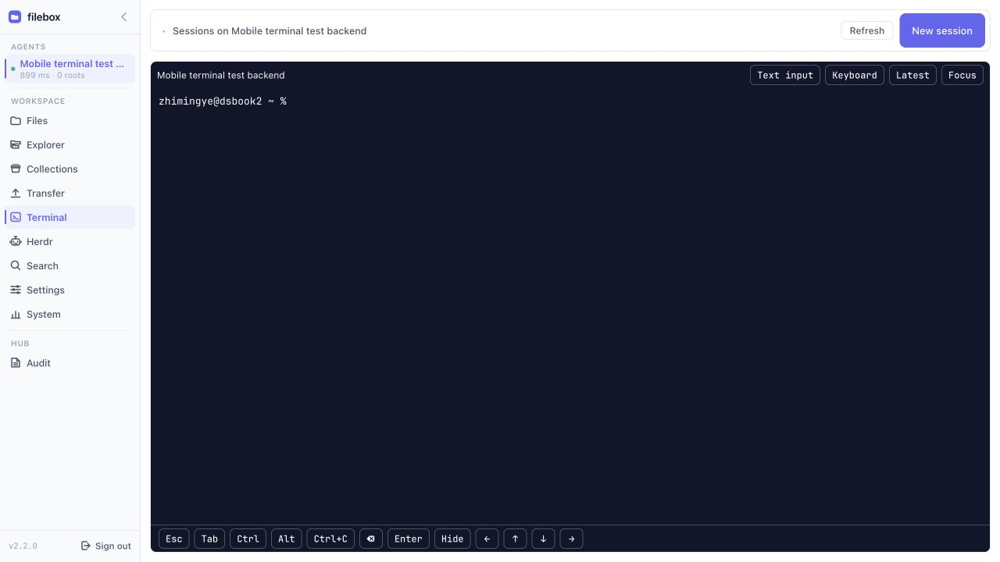
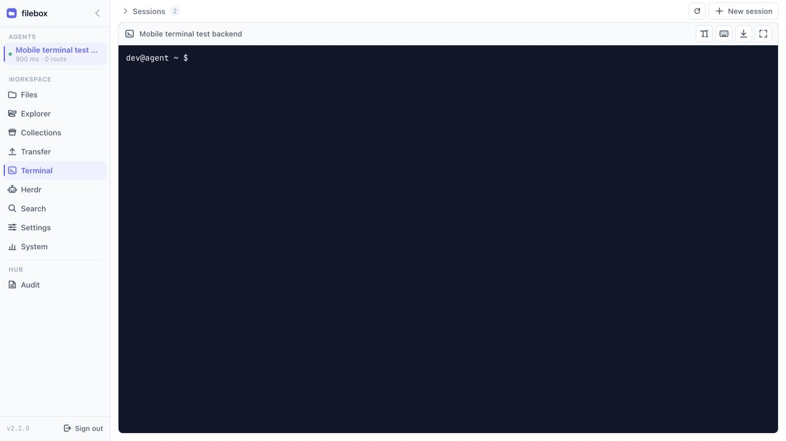
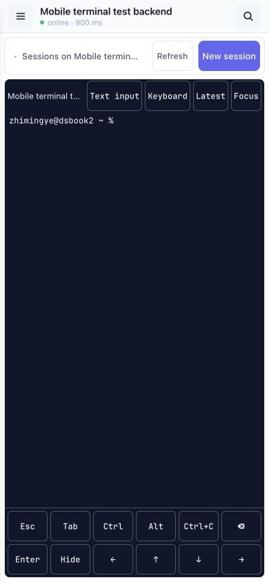
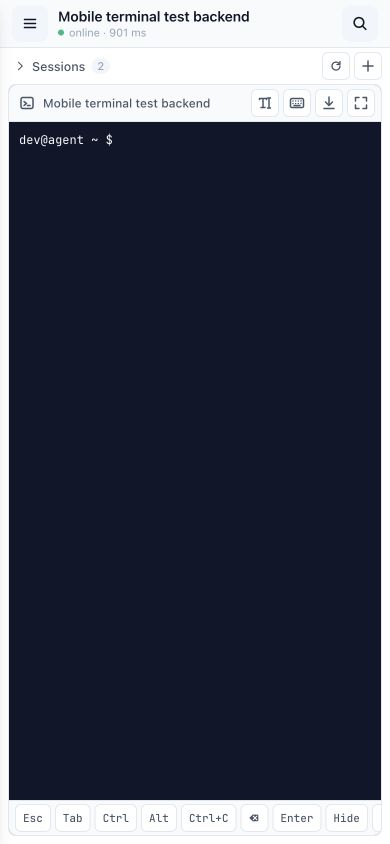
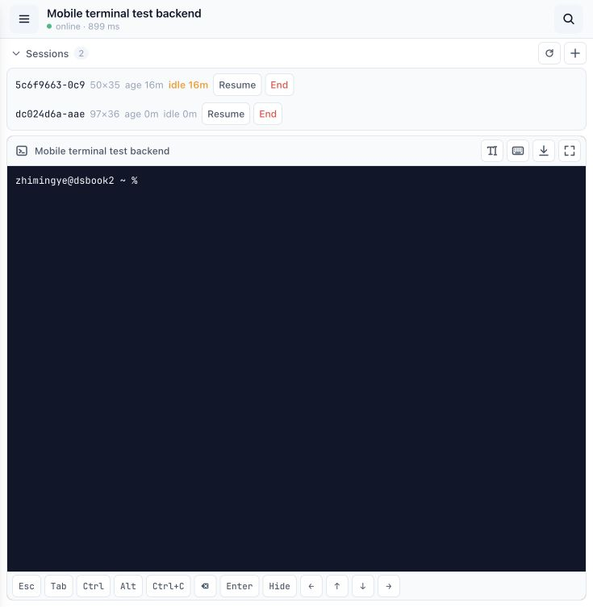
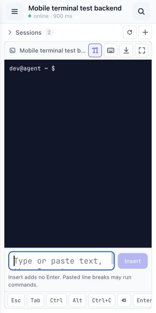
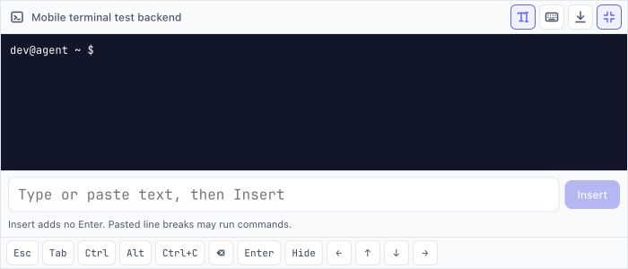
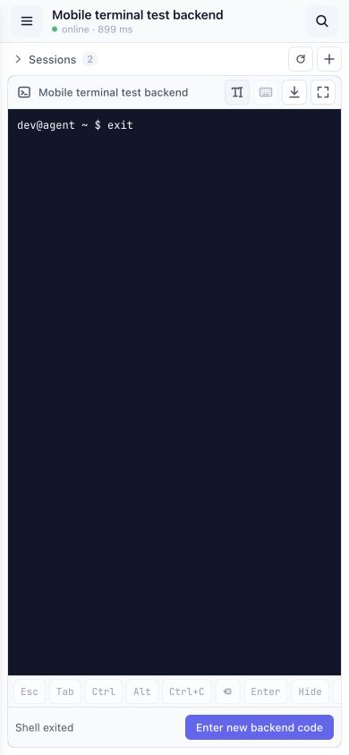

# Terminal controls: visual review

Captured on 2026-10-15 with an isolated local Hub, Agent, and real PTY. The
sidebar version is that of the existing test binary, not a production deployment.
The shell prompt was changed to `dev@agent` for the final screenshots.

## What needed correction

The terminal had drifted from the Files view's small SVG controls, light surfaces,
sans-serif labels, and quiet borders. Session creation dominated the header; dark
outlined text buttons looked unrelated to the app. On phones, twelve auxiliary
keys stretched into two full-width rows, taking space from terminal output.

## Desktop — 1280 × 720

Before:

After: session actions and display controls use compact light toolbar chrome.
The keyboard icon exposes optional auxiliary keys; they are collapsed by default.

## Phone — 390 × 844

Before:

After: one horizontally scrollable key strip replaces the stretched two-row grid.
Keys and toolbar actions are 28px high with no added invisible touch padding.
Session actions stay together instead of placing End at the far edge. Accessible names remain on every icon button.

## Checked states

1. **Desktop controls — passed.** Same visual language as Files; keyboard toggle
   does not recreate xterm or spend another ticket. Hiding keys clears modifiers.
2. **Phone controls — passed.** Compact single row; horizontal scrolling reveals
   arrows and remaining keys. Page width stays within the viewport.
3. **Native input at 320px — passed.** Text field and Insert fit; sending a command
   through the real PTY works and auxiliary keys preserve input focus.
4. **Focused landscape at 700 × 300 — passed.** Text entry, terminal output and
   auxiliary keys remain visible. No horizontal page overflow.
5. **Session list — passed.** Expanded rows, Resume and End remain accessible;
   the list retains its own scroll area.
6. **Shell exit — passed.** Light status area shows the reason and fresh-code
   recovery action. Input is disabled after closure.

## Scope and limits

Frontend behavior tests, TypeScript/production build, touched-file ESLint, and
the documentation build pass. No protocol, authentication, output queue, or
touch-history-scrolling implementation changed. No dependency was added.

These screenshots and browser interactions cover responsive layout, not physical
iOS/Android soft keyboards or low-end device performance. Screen-reader behavior
was not manually audited; controls retain accessible names and native focus
outlines, and control dimensions were measured in the rendered DOM.
