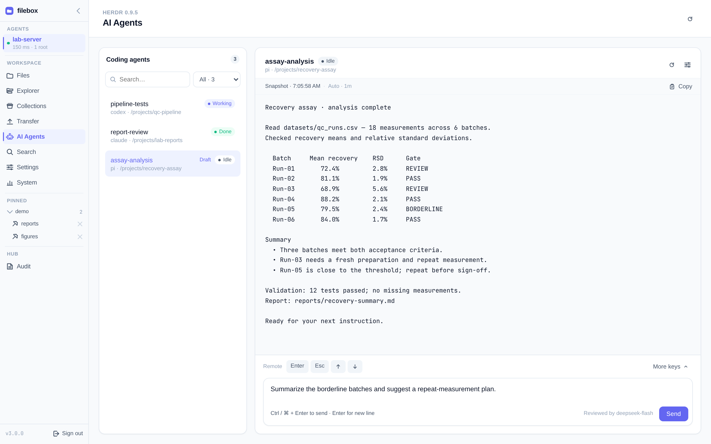
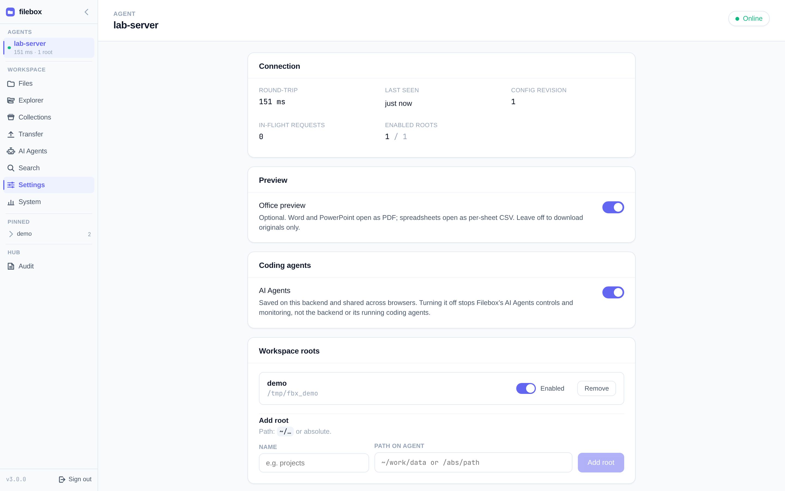
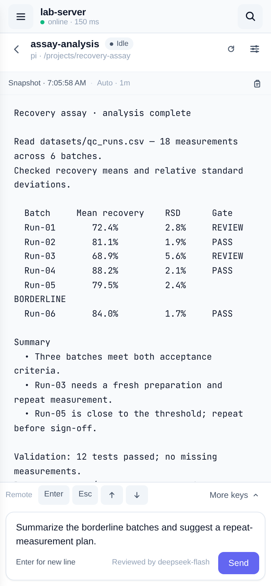

# AI Agents

Use **AI Agents** on the selected Filebox Agent to list coding-agent windows, read output, send prompts and answer with allowlisted keys. This is a separate backend integration, not a remote shell or a read-only preview.

## Enable and set up

In **Settings** (Agent Settings), turn on **AI Agents** and choose its backend. The switch is saved on that Agent and shared across browsers. Turning it off stops Filebox controls and monitoring, not the backend or running coding agents.

- **Herdr**: install the [Herdr CLI](https://herdr.ink) on the Agent machine (checked against v0.9.5). Put `herdr` on the Agent process's PATH or set `FILEBOX_AGENT_HERDR` to its executable, then use **Check installation**.
- **hc (experimental)**: connects local live herdr-core terminals opted in with `fb=<name>` or `filebox=<name>` labels. See [experimental hc setup](/ops/agent#experimental-hc-backend). Automatic selection prefers Herdr when both are installed.

**Meet AI Agents** introduces the integration; **Set up AI Agents** explains missing installation or disabled settings. **AI agent backend is not running** means the CLI was found but the backend needs to be started on the Agent machine.

At Agent startup, `FILEBOX_AGENT_AI_AGENTS_ENABLED=0` / `1` overrides and locks the switch. `FILEBOX_AGENT_AI_AGENTS_BACKEND` locks backend selection. Remove the relevant variable and restart the Agent to restore web control.

## Windows, output and input

- Search windows by name, agent kind, working directory or pane ID; filter by status when the backend supports status detection. **Draft** marks unsent input. Each window keeps its own draft while the view is mounted; rejected prompts retain it.
- Select a window to read its output. **Refresh output** gets a fresh snapshot; AI Agents settings controls automatic output refresh. Refresh does not scroll the remote application's transcript.
- Send a prompt from the composer. Enter adds a line; Ctrl / ⌘ + Enter sends. Inspect output before retrying an interrupted send: cancelling a wait cannot retract accepted input.
- Use Enter, Esc and Up/Down, or open **Keys** for searchable pi, Claude Code and Codex shortcut profiles. Detection picks a profile; you can correct it. Opening Keys or changing profiles sends nothing. Shortcuts use a bounded allowlist, not arbitrary raw input; upstream support and custom keybindings can differ.
- Needs-input reminders require an open Filebox page. Detection can miss questions; reminders are not a guarantee of notification when the page is closed.

## Prompt review

By default, every prompt is reviewed at the Hub before delivery. Destructive commands, permanent deletion and secret extraction are blocked; normal data analysis and development are allowed. The reviewer sees your prompt and the window's recent output.

The view shows review **on with its model**, **off**, or **not configured** (prompts disabled). Missing configuration or a failed review refuses delivery rather than bypassing review. Reads, status and allowlisted keys remain available; keys are not LLM-reviewed. Coding agents can modify files outside browse roots, so use their controls with care.

An administrator configures review only on the Hub, not in the browser. See [Prompt review (AI Agents)](/ops/hub#prompt-review-ai-agents).
