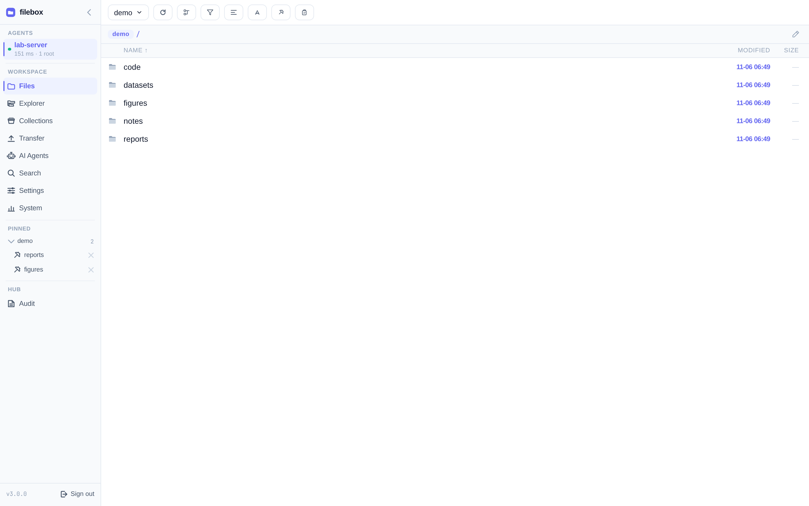
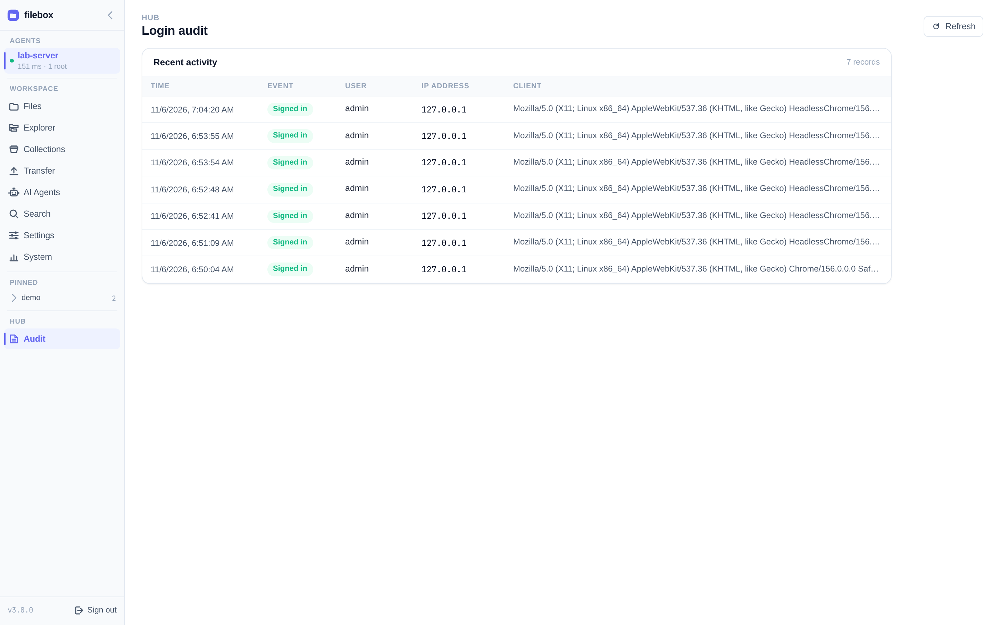

# Security & sensitive files

filebox’s default posture: **read-only browse, path jail, sensitive files denied**. Transfer writes only to a dedicated scratch folder. AI Agents uses a separate, whitelisted CLI integration for coding-agent operations.



## Read-only protocol

Browse paths have no write / delete / rename / arbitrary exec messages.

| Exception | Scope | Protections |
|-----------|-------|-------------|
| **Transfer** | Agent scratch directory only | Quotas, no overwrite, not a normal root |

## Sensitive files denied by default (excerpt)

Even inside authorized roots, matching paths are unreadable:

```text
.git/  .ssh/  .gnupg/  .aws/  .kube/
.env*  *.pem  *.key  id_*  credentials*.json  *.sqlite*
```

plus common credential locations such as shell history. Exact rules follow the current release implementation.

## Path jail

Browse is strictly limited to added roots; `..` and symlink escapes are blocked.

## Auth and trust

- User login happens on the Hub (PoW + session cookie + CSRF).
- Each machine uses its own Agent token (Hub stores only a hash).
- Agents dial out to the Hub; targets need no inbound exposure.
- Production must use HTTPS to protect tokens and sessions.
- Login events appear under sidebar **Audit**.



## Architecture notes

Deeper Hub↔Agent trust boundaries, tokens, and rate limits live in the repo developer doc
[`docs/hub-agent-security-model.md`](https://github.com/ZhimingYe/filebox/blob/main/docs/hub-agent-security-model.md) (Chinese).

## AI Agents and prompt review

AI Agents is not a read-only file preview: coding agents can run actions and modify files outside browse roots. By default, the Hub reviews prompts with an LLM, blocking destructive commands, permanent deletion and secret extraction while allowing normal data analysis and development. The reviewer sees the prompt and recent target-window output. Missing configuration or review failure refuses delivery and keeps the draft. Status, output reads and allowlisted keys remain available; keys are not LLM-reviewed. Administrators can explicitly disable review at Hub startup. See [prompt review](/ops/hub#prompt-review-ai-agents).
