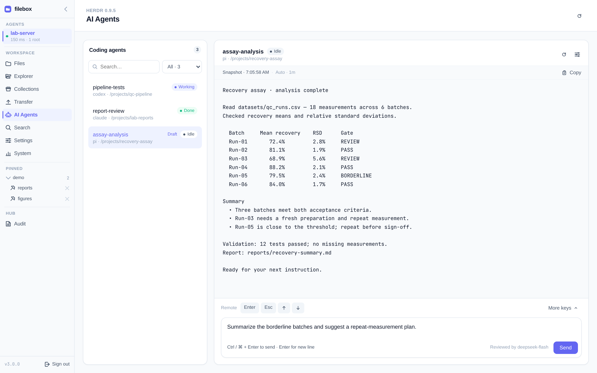

# Configure LLM review

If you use **AI Agents** to send prompts to coding agents, configure an LLM provider after [installing the Hub](./install-hub). Prompt review is **on and mandatory by default**: without a configured reviewer, every prompt is rejected. Provider errors, timeouts or invalid review responses also refuse delivery (fail-closed).

This step is not required for file browsing or previews. AI Agents status, output reads and allowlisted keys remain available without a reviewer; keys are not LLM-reviewed. The reviewer receives the prompt and recent output from the target window, so choose a provider appropriate for that data.

## Run the setup wizard

From the Hub package directory, after `./bin/hub --init-config` has created `config/hub.json`:

```bash
./bin/hub --init-llm
```

For a different existing configuration file:

```bash
./bin/hub --init-llm --output /path/to/hub.json
```

1. Choose a provider preset or **Custom**; confirm its base URL, optional endpoint path and provider name.
2. Choose an environment-variable API key (recommended) or an inline key.
3. Select a model returned by the provider or enter its identifier manually.
4. The wizard tests chat, JSON output and a thinking-enabled tool call. If a test fails, it asks whether to save anyway; resolve provider errors before relying on review.
5. Choose to use this provider for **AI Agents prompt review**.

The wizard preserves other Hub settings. With environment-variable storage, if the variable is missing, it asks for a key for its tests; that testing key is **not saved**. Supply the variable to the running Hub too, then restart the Hub to apply the configuration. The wizard does not disable review.

## Configure `hub.json`

The wizard writes a named provider and a review reference. You can also merge these fields into the existing `hub.json`; **do not replace your authentication settings**:

```json
{
  "llm_providers": {
    "deepseek": {
      "protocol": "chat_completions",
      "base_url": "https://api.deepseek.com",
      "model": "deepseek-flash",
      "api_key_env": "DEEPSEEK_API_KEY",
      "timeout_secs": 20
    }
  },
  "prompt_review": {"provider": "deepseek"}
}
```

Provider names start with an ASCII letter or digit and contain only ASCII letters, digits, `_` or `-`, up to 64 characters. `prompt_review.provider` must name an entry in `llm_providers`; the reference can also override `model` and `timeout_secs`. Legacy inline provider configuration under `prompt_review` remains supported.

| Provider field | Meaning |
|----------------|---------|
| `protocol` | `chat_completions`, `responses` or `messages` |
| `base_url` | Provider base URL; HTTPS is required except for loopback hosts. No credentials, query or fragment in the URL. |
| `path` | Optional endpoint path override; must start with `/`, with no query, fragment, `..` or whitespace. |
| `model` | Model identifier to use for review |
| `api_key_env` | Name of the environment variable containing the API key |
| `api_key` | Alternative inline key in the private config; prefer `api_key_env` |
| `timeout_secs` | Default 20 seconds. The provider client clamps to 1–300 seconds; Hub prompt review clamps to 1–60 seconds. |

Default endpoint paths are `/chat/completions`, `/responses` and `/anthropic/v1/messages`, respectively. For the official Anthropic API, use `base_url: "https://api.anthropic.com"` and `path: "/v1/messages"` with protocol `messages` and an appropriate model/key.

## Supply the API key to the Hub service

An exported variable in your interactive shell is not automatically available to systemd. For the [systemd deployment](./install-hub#systemd-example-optional), add an `EnvironmentFile=` entry under `[Service]` in the Hub unit or a drop-in:

```ini
[Service]
EnvironmentFile=/etc/filebox-hub/llm.env
```

Create that file with the real key (replace the placeholder), restrict it to the service administrator, and keep it out of version control:

```ini
DEEPSEEK_API_KEY=replace-with-your-provider-key
```

For a system service, a root-owned file with mode `0600` is appropriate. After changing the unit, reload systemd and restart the service (replace `filebox-hub.service` with your unit name):

```bash
sudo systemctl daemon-reload
sudo systemctl restart filebox-hub.service
```

For manual or container deployments, pass the same variable to the Hub process before starting it. A missing or empty key for a configured review provider fails configuration validation at startup.

## Verify review is configured

Open **AI Agents**, select a window, and check for **Reviewed by deepseek-flash** (or your configured model). Missing review configuration instead shows **Prompts disabled: configure prompt_review in hub.json**, or **Prompt review not configured** in compact/mobile layouts.



The model label confirms configuration, not provider availability. Send a harmless prompt appropriate for the selected coding agent to check delivery. If review fails, the prompt is not forwarded and the draft stays available; check the service's API-key environment, endpoint, model and provider availability before retrying. See [AI Agents](/features/ai-agents) for usage and review boundaries.

## Explicitly disable review

Only if you intend to forward prompts **without LLM review**, start the Hub with `FILEBOX_HUB_PROMPT_REVIEW_ENABLED=0` (or `false`). With systemd, add this to the service's `[Service]` section, reload systemd and restart the Hub:

```ini
Environment=FILEBOX_HUB_PROMPT_REVIEW_ENABLED=0
```

The setting is read once at startup. Unset, `1`, `true` or invalid values keep review mandatory. The AI Agents view shows **Prompt review off** when disabled; removing `prompt_review` from JSON alone does not disable review.

Next: [Install Agent](./install-agent)
