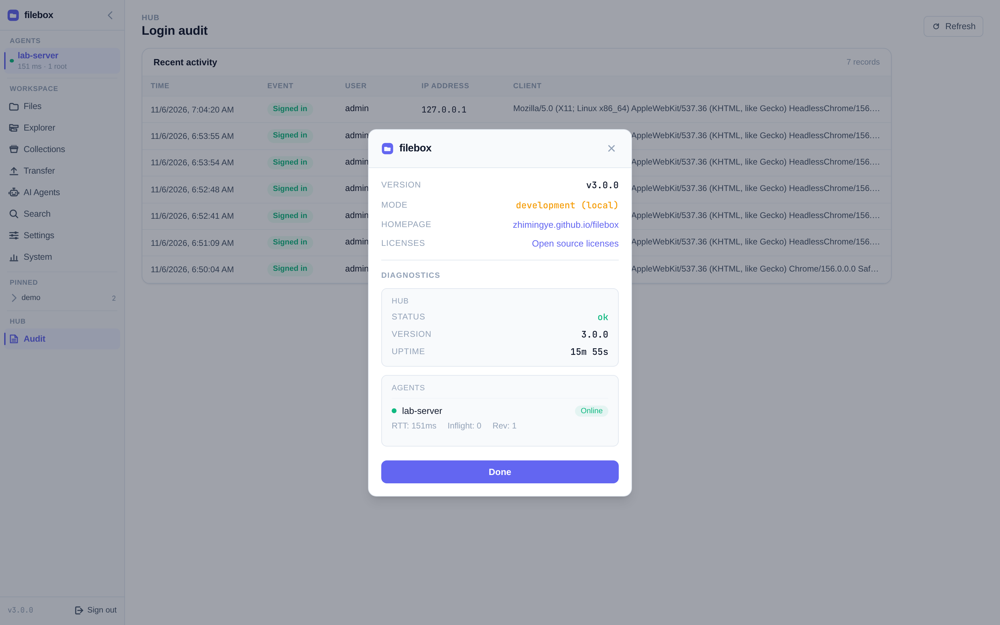
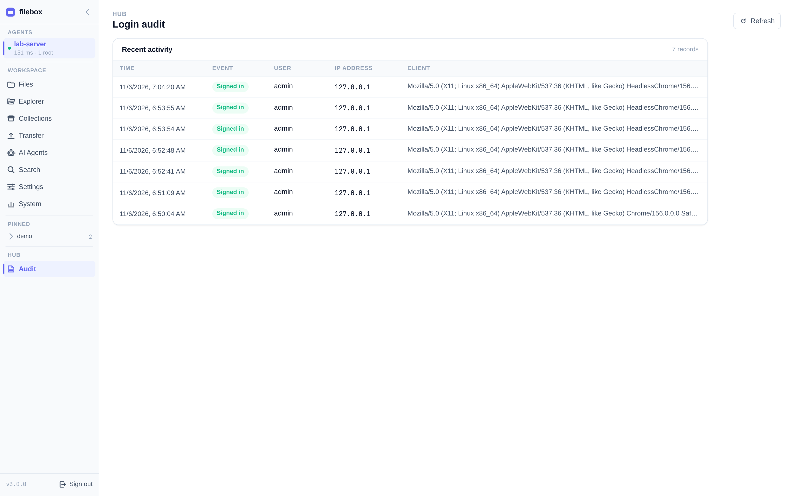
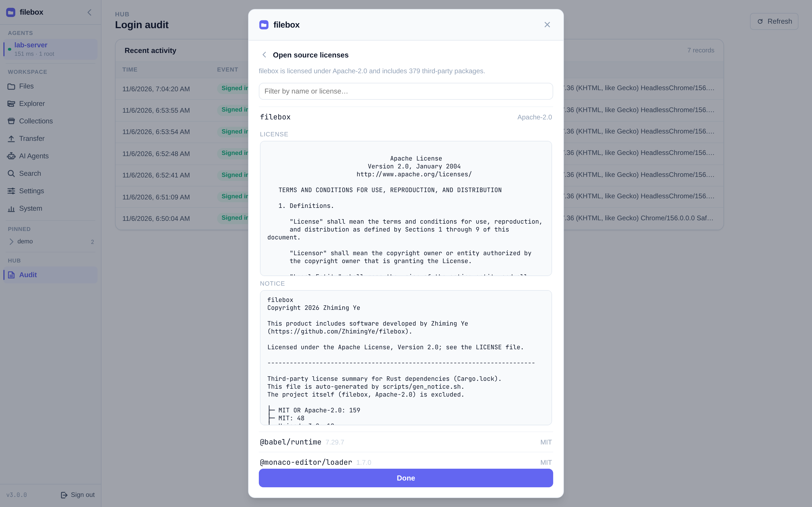

# Hub config & HTTPS

The Hub is the only central service both browsers and Agents must reach. Always put TLS termination in front in production.

## Quick recap

1. `./bin/hub --init-config` → writes `config/hub.json`, **prints the Agent token once**  
2. Reverse-proxy terminates TLS and forwards WebSockets (below)  
3. Agent Hub URL uses `https://filebox.example.com`  
4. `./bin/hub --update` upgrades in place  

Full install steps: [Install Hub](/guide/install-hub).

## Config fields

| Field | Meaning | Default |
|-------|---------|---------|
| `listen_addr` | Listen address | `0.0.0.0:3000` |
| `agent_token_hash` | bcrypt hash of the Agent token | set at init |
| `llm_providers` | Named LLM providers: protocol, URL, model and API key source | unset |
| `prompt_review` | Review provider reference (or legacy inline config); file-only | unset (prompts rejected) |
| `users` | Login accounts | set at init |

Env vars: `FILEBOX_DEV_MODE`, `FILEBOX_LISTEN_ADDR`, `FILEBOX_FRONTEND_DIR`, `FILEBOX_CONFIG_PATH`, `FILEBOX_TRUST_XFF`, `FILEBOX_HUB_PROMPT_REVIEW_ENABLED`.

## HTTPS and WebSocket

The Hub process itself is HTTP. Minimal nginx:

```nginx
location / {
    proxy_pass http://127.0.0.1:3000;
    # Preserve the port for HTTPS listeners other than 443.
    proxy_set_header Host $http_host;
    proxy_set_header X-Forwarded-For $proxy_add_x_forwarded_for;
    proxy_set_header X-Forwarded-Proto $scheme;
    proxy_http_version 1.1;
    proxy_set_header Upgrade $http_upgrade;
    proxy_set_header Connection "upgrade";
    proxy_buffering off;
    proxy_cache off;
}
```

Without WebSocket upgrade, Agents vanish from the sidebar or flap constantly.

For local development, `FILEBOX_ALLOW_INSECURE_HUB=1` lets Agents use `http://` — **never** in production.

## Health check

```bash
curl -s https://filebox.example.com/api/health
```

UI: click sidebar **v3.x.x** for About / Diagnostics (Hub status, uptime, Agents).



## Login audit

Sidebar **Audit**: success / failure / rate-limit and logout events in a rolling JSONL next to the Hub (~2000 entries). Does not depend on the selected Agent.



## Updates

```bash
./bin/hub --update
```

## Prompt review (AI Agents)

AI Agents prompts require Hub-side LLM security review by default; missing configuration, provider unavailability or review failure refuses delivery. Status, output reads and allowlisted keys remain available; keys are not LLM-reviewed. For deployment steps, provider fields, service environment variables and opting out, see [Configure LLM review](/guide/llm-review).

## Third-party licenses

Click the sidebar version for **About / Diagnostics** → **Open source licenses**. Filter by package name or license, then expand entries to read full license texts of bundled Rust and frontend dependencies.


