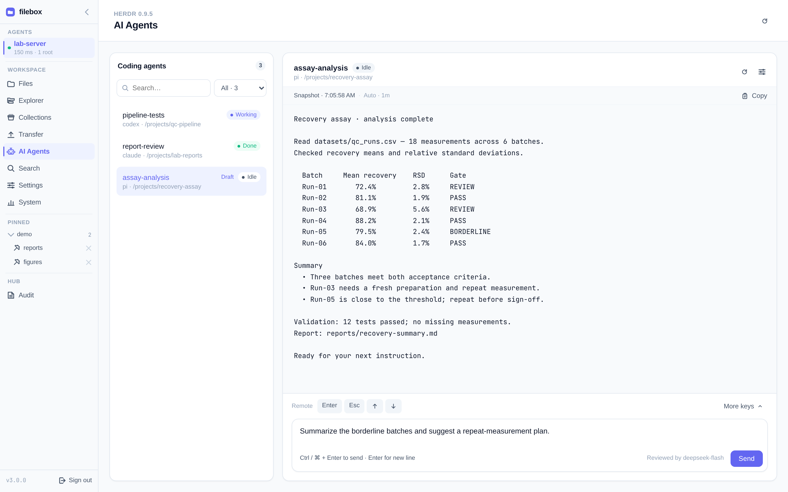
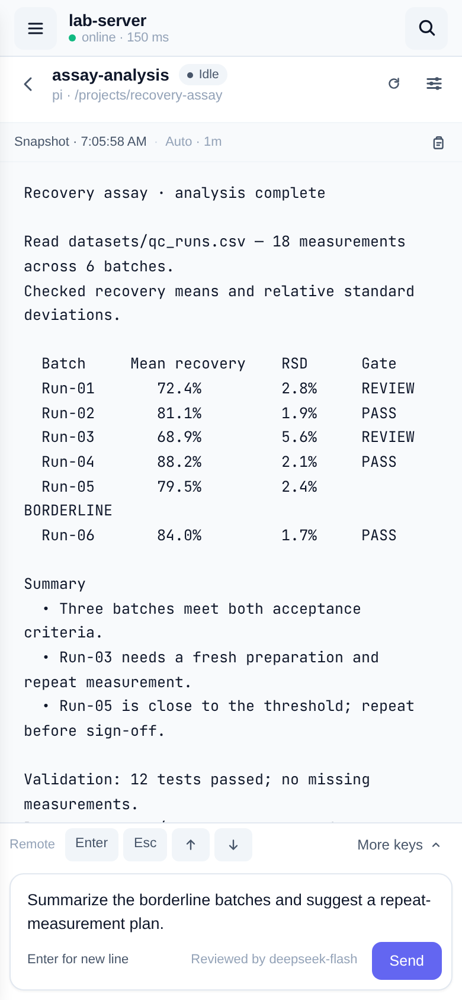

# AI Agents 编码代理

在选中的 Filebox Agent 上打开 **AI Agents**，列出编码代理窗口、读取输出、发送提示词、使用白名单按键作答。这是独立的后端集成，不是远程 shell，也不是只读预览。

## 启用与安装

在 **Settings**（Agent Settings）中打开 **AI Agents** 并选择后端。开关保存在该 Agent 上，跨浏览器共享。关闭只停止 Filebox 的控制与监测，不会停止后端或正在运行的编码代理。

- **Herdr**：在 Agent 机器上安装 [Herdr CLI](https://herdr.ink)（已对照 v0.9.5）。让 Agent 进程的 PATH 能找到 `herdr`，或用 `FILEBOX_AGENT_HERDR` 指定可执行文件，再点 **Check installation**。
- **hc (experimental)**：接入以 `fb=<名称>` 或 `filebox=<名称>` 标签明确授权的本地运行中 herdr-core 终端。见 [实验性 hc 配置](/zh/ops/agent#experimental-hc-backend)。两者都安装时，自动选择优先使用 Herdr。

**Meet AI Agents** 介绍功能；**Set up AI Agents** 说明未安装或已关闭的状态。**AI agent backend is not running** 表示已找到 CLI，但需在 Agent 机器上启动后端。

Agent 启动时的 `FILEBOX_AGENT_AI_AGENTS_ENABLED=0` / `1` 会覆盖并锁定开关；`FILEBOX_AGENT_AI_AGENTS_BACKEND` 锁定后端选择。移除对应环境变量并重启 Agent 后可恢复网页控制。

## 窗口、输出与输入

- 按名称、代理类型、工作目录或 pane ID 搜索窗口；后端支持状态检测时可按状态筛选。**Draft** 标出未发送输入。视图挂载期间各窗口保留各自草稿，提示词被拒绝时也不会丢失。
- 选择窗口读取输出。**Refresh output** 获取新快照；AI Agents 设置中可控制自动刷新。刷新不会滚动远端应用自身的对话记录。
- 在输入区发送提示词。Enter 换行，Ctrl / ⌘ + Enter 发送。中断发送后重试前先检查输出：取消等待不能撤回已接受的输入。
- 使用 Enter、Esc 和 Up/Down，或打开 **Keys**，搜索 pi、Claude Code、Codex 快捷键配置。自动检测会选择配置，也可手动纠正。打开 Keys 或切换配置不会发送按键。快捷键受白名单限制，不提供任意原始输入；上游支持及自定义键位可能不同。
- 需要输入的提醒要求 Filebox 页面保持打开。检测可能漏掉问题，关闭页面后不保证通知。

## 提示词审核

默认每条提示词先在 Hub 审核再发送。破坏性命令、永久删除、提取密钥会被阻止；正常数据分析与开发允许通过。审核器会看到提示词与窗口近期输出。

视图显示审核**已开启及模型**、**已关闭**或**未配置**（禁用提示词）。未配置或审核失败时拒绝发送，不会绕过审核。读取输出、状态与白名单按键仍可用；按键不经 LLM 审核。编码代理可以修改浏览 root 之外的文件，请谨慎操作。

审核仅由管理员在 Hub 配置，不能在浏览器中配置。见 [提示词审核（AI Agents）](/zh/guide/llm-review)。
