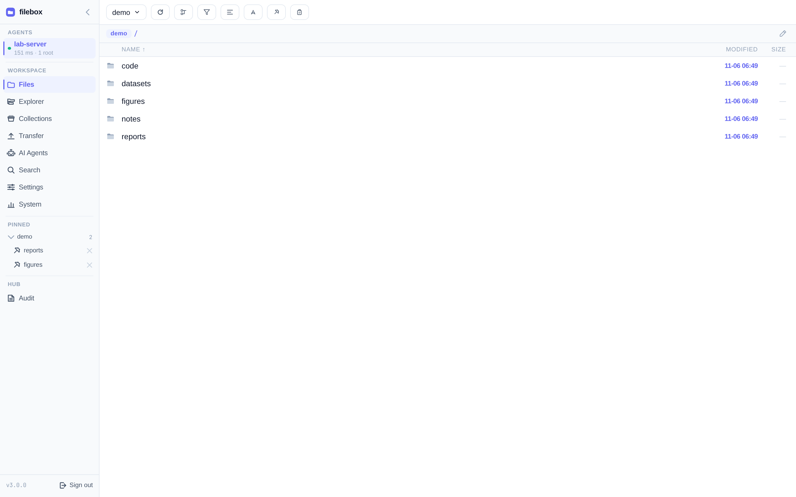
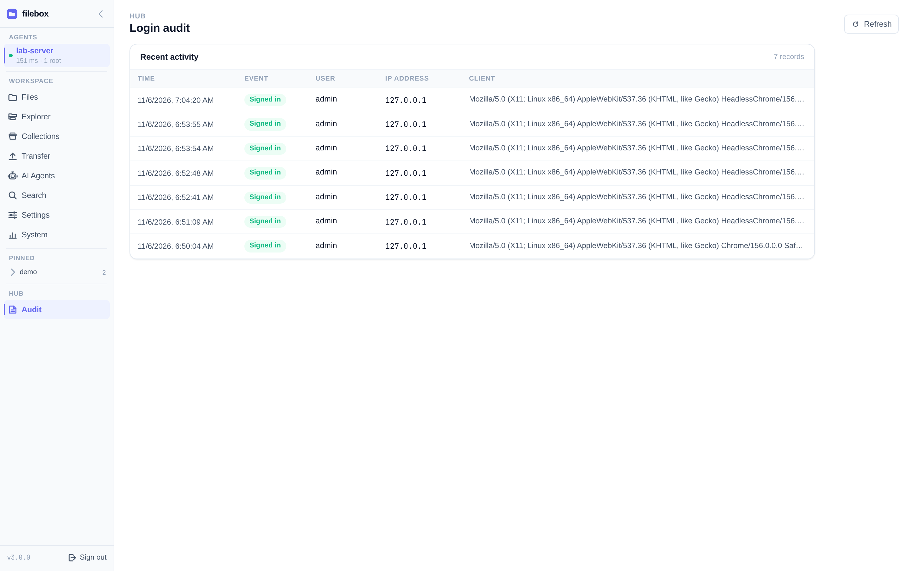

# 安全与敏感文件

filebox 的默认姿态是：**浏览只读、路径牢笼、敏感文件拒绝**。Transfer 仅写入专用临时目录。AI Agents 通过独立的白名单后端管理编码代理。



## 只读协议

浏览路径没有写 / 删 / 重命名 / 任意 exec 消息。

| 例外 | 作用域 | 防护 |
|------|--------|------|
| **Transfer** | 仅 Agent 专用 scratch 目录 | 配额、禁覆盖、不作为普通 root |

## 敏感文件默认拒绝（节选）

即使根目录已授权，匹配项仍不可读：

```text
.git/  .ssh/  .gnupg/  .aws/  .kube/
.env*  *.pem  *.key  id_*  credentials*.json  *.sqlite*
```

以及 shell history 等常见凭证位置。具体规则以当前版本实现为准。

## 路径牢笼

浏览严格限制在已添加的 root 内；`..`、符号链接逃逸等会被挡住。

## 认证与信任

- 用户登录在 Hub（PoW + 会话 cookie + CSRF）。
- 每台机器用独立 Agent token（Hub 只存 hash）。
- Agent 出站连 Hub；目标机无需入站。
- 生产环境务必 HTTPS，保护 token 与会话。
- 登录事件见侧栏 **Audit**。



## 架构向说明

更底层的 Hub↔Agent 信任边界、token、限流等见仓库内开发文档
[`docs/hub-agent-security-model.md`](https://github.com/ZhimingYe/filebox/blob/main/docs/hub-agent-security-model.md)（中文）。

## AI Agents 与提示词审核

AI Agents 不是只读文件预览：编码代理可执行操作、修改文件，不受浏览 root 限制。提示词默认先由 Hub 的 LLM 审核，阻止破坏性命令、永久删除和提取密钥，允许正常数据分析与开发。审核器会看到提示词及目标窗口近期输出；未配置或审核失败时拒绝发送，草稿保留。状态、读取输出与白名单按键仍可用，按键不经 LLM 审核。管理员可在 Hub 启动时显式关闭审核。见 [提示词审核](/zh/guide/llm-review)。
