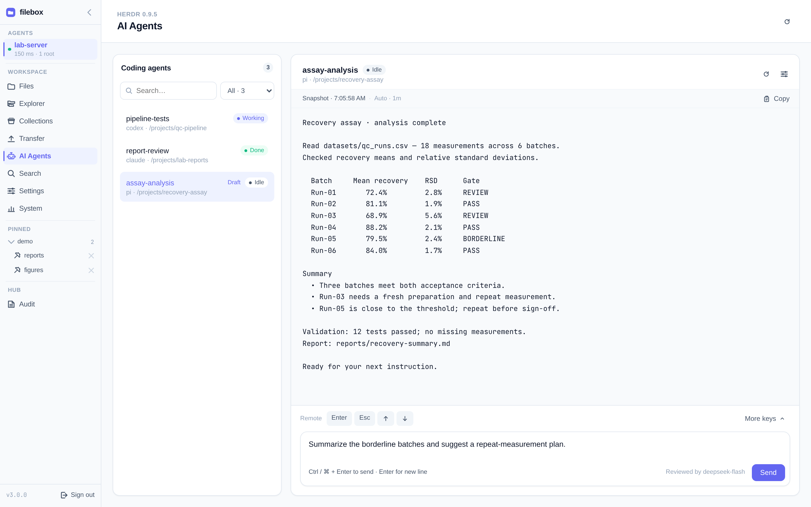

# 配置 LLM 审核

如果要通过 **AI Agents** 向编码代理发送提示词，请在[部署 Hub](./install-hub) 后配置 LLM 提供商。提示词审核**默认开启且强制执行**：未配置审核器时，每条提示词都会被拒绝。提供商出错、超时或审核响应无效时也拒绝发送（fail-closed）。

仅浏览文件或预览时不需要这一步。未配置审核器时，AI Agents 状态、读取输出与白名单按键仍可用；按键不经 LLM 审核。审核器会收到提示词与目标窗口的近期输出，请选择适合处理这些数据的提供商。

## 运行配置向导

在 Hub 发布包目录中，先通过 `./bin/hub --init-config` 创建 `config/hub.json`，再执行：

```bash
./bin/hub --init-llm
```

使用其他已有配置文件时：

```bash
./bin/hub --init-llm --output /path/to/hub.json
```

1. 选择提供商预设或 **Custom**，确认基础 URL、可选端点路径和提供商名称。
2. 选择环境变量 API key（推荐）或内联密钥。
3. 从提供商返回的列表中选择模型，或手动输入模型标识。
4. 向导测试聊天、JSON 输出和带 thinking 的工具调用。测试失败时会询问是否仍保存；请先解决提供商错误，再依赖审核。
5. 选择将此提供商用于 **AI Agents prompt review**。

向导保留其他 Hub 设置。选择环境变量存储时，若变量不存在，会询问用于测试的密钥；该测试密钥**不会保存**。还需将变量传给运行中的 Hub，保存后重启 Hub 使配置生效。向导不会关闭审核。

## 配置 `hub.json`

向导写入命名提供商与审核引用。也可将以下字段合并到已有 `hub.json`；**不要替换认证配置**：

```json
{
  "llm_providers": {
    "deepseek": {
      "protocol": "chat_completions",
      "base_url": "https://api.deepseek.com",
      "model": "deepseek-flash",
      "api_key_env": "DEEPSEEK_API_KEY",
      "timeout_secs": 20
    }
  },
  "prompt_review": {"provider": "deepseek"}
}
```

提供商名称以 ASCII 字母或数字开头，仅包含 ASCII 字母、数字、`_` 或 `-`，最长 64 个字符。`prompt_review.provider` 必须引用 `llm_providers` 中的条目；引用中还可覆盖 `model` 与 `timeout_secs`。旧式直接在 `prompt_review` 下内联提供商配置的方式仍受支持。

| 提供商字段 | 含义 |
|------------|------|
| `protocol` | `chat_completions`、`responses` 或 `messages` |
| `base_url` | 提供商基础 URL；除回环地址外必须使用 HTTPS。URL 不可包含凭据、查询串或片段。 |
| `path` | 可选端点路径覆盖；必须以 `/` 开头，不含查询串、片段、`..` 或空白。 |
| `model` | 用于审核的模型标识 |
| `api_key_env` | 存储 API key 的环境变量名 |
| `api_key` | 也可在私有配置中内联密钥；推荐使用 `api_key_env` |
| `timeout_secs` | 默认 20 秒。提供商客户端限制为 1–300 秒；Hub 提示词审核限制为 1–60 秒。 |

三个协议的默认端点路径依次为 `/chat/completions`、`/responses` 和 `/anthropic/v1/messages`。使用官方 Anthropic API 时，设置 `base_url: "https://api.anthropic.com"`、`path: "/v1/messages"`、协议 `messages`，并选择合适的模型与密钥。

## 将 API key 传给 Hub 服务

交互式 shell 中导出的变量不会自动传给 systemd。采用 [systemd 部署](./install-hub#systemd-示例可选) 时，在 Hub 单元或 drop-in 的 `[Service]` 下加入 `EnvironmentFile=`：

```ini
[Service]
EnvironmentFile=/etc/filebox-hub/llm.env
```

创建该文件并填入真实密钥（替换占位符），限制为服务管理员可访问，不要纳入版本控制：

```ini
DEEPSEEK_API_KEY=replace-with-your-provider-key
```

对于系统服务，可使用 root 所有、权限为 `0600` 的文件。修改单元后重载 systemd 并重启服务（将 `filebox-hub.service` 替换为实际单元名）：

```bash
sudo systemctl daemon-reload
sudo systemctl restart filebox-hub.service
```

手动运行或使用容器时，在启动 Hub 前将同名变量传给 Hub 进程。已配置审核提供商但密钥缺失或为空时，启动配置校验会失败。

## 验证审核已配置

打开 **AI Agents**，选择一个窗口，检查是否显示 **Reviewed by deepseek-flash**（或配置的模型）。未配置审核时会显示 **Prompts disabled: configure prompt_review in hub.json**；紧凑布局或手机上显示 **Prompt review not configured**。



模型标签仅说明已配置，不代表提供商可用。向选中的编码代理发送一条合适的无害提示词，验证能否送达。审核失败时不会转发提示词，草稿仍保留；重试前检查服务的 API key 环境变量、端点、模型与提供商可用性。使用方式与审核边界见 [AI Agents](/zh/features/ai-agents)。

## 显式关闭审核

只有确定要**不经 LLM 审核转发提示词**时，才在启动 Hub 时设置 `FILEBOX_HUB_PROMPT_REVIEW_ENABLED=0`（或 `false`）。使用 systemd 时，在服务的 `[Service]` 下加入以下内容，重载 systemd 并重启 Hub：

```ini
Environment=FILEBOX_HUB_PROMPT_REVIEW_ENABLED=0
```

此设置仅在启动时读取。未设置、`1`、`true` 或无效值均保持强制审核。关闭后 AI Agents 显示 **Prompt review off**；仅从 JSON 删除 `prompt_review` 不会关闭审核。

接下来：[部署 Agent](./install-agent)
